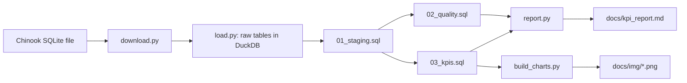

# Chinook sales analytics

A small, reproducible SQL analytics pipeline on the Chinook sample database (a digital music store): Python and DuckDB load the data, 13 data quality checks verify it, and revenue KPIs by year, genre and artist are published as charts and a report right here on GitHub.


## Business questions
1. How does revenue develop from year to year?
2. Which genres bring the most revenue?
3. Which artists bring the most revenue?

Full KPI definitions and their limits: [docs/kpi_definitions.md](docs/kpi_definitions.md). All tables: [docs/kpi_report.md](docs/kpi_report.md).

## Key findings

### 1. Revenue per year stays in a narrow band
Yearly revenue was between 449 and 481 over five years (2021-2025), with changes of +7.1%, -2.5%, +1.7% and -5.6%. There is no clear trend. The last year is not fully comparable: the data ends on 22 December and 2025 has 80 invoices against 83 in every other year.


Exactly 83 invoices in each of 2021–2024 suggests generated data, not a real business, so I would not draw business conclusions from the trend. What the data does show is that the small differences in yearly revenue come from the average invoice value (5.42–5.80), not from the number of invoices.

### 2. Rock dominates, and the top four genres bring almost three quarters
Rock alone brings 35.5% of revenue (826.65 of 2,328.60). Rock, Latin, Metal and Alternative & Punk together bring 73.5%. TV Shows is 5th by revenue (93.53) with only 47 units sold, because an episode costs about 1.99 against 0.99 for a typical track, so revenue rank and units rank differ.


Rock's share of revenue (35.5%) is close to its share of the catalog (37.0%), so rock leads mostly because there are more rock tracks, not necessarily because rock sells better. The data has no information about advertising or demand, so it cannot say whether promoting other genres would help.

### 3. Revenue is spread across many artists
The top 10 of 165 artists with sales bring 31% of revenue. Iron Maiden is first with 138.60 (5.95%), ahead of U2 and Metallica. TV series such as Lost and The Office appear next to bands, because the catalog stores TV shows as artists.


Iron Maiden, U2 and Metallica lead, but even the top 10 artists bring only 31% of revenue, so revenue is not concentrated in a few artists.

## Data quality
Thirteen checks run on every build (`sql/02_quality.sql`) and all pass:
- invoice totals equal the sum of their lines, and every invoice has lines;
- every invoice line points to an existing invoice and track, every invoice to an existing customer, every track has a genre;
- primary keys are unique;
- dates are present and not in the future, prices, quantities and totals are positive, the billing country is filled in.

While building the checks I first compared invoice totals with the sum of their lines using floating-point numbers (`DOUBLE`) and got 56 "mismatches". They were rounding noise: after casting prices to `DECIMAL(10,2)` the number of mismatches is 0. The staging views therefore use `DECIMAL` for all money columns. Column types, row counts and cleaning rules are in [docs/data_dictionary.md](docs/data_dictionary.md).

Two simple tests (`tests/test_sql.py`) re-check that all quality checks pass and that revenue in every KPI adds up to the invoice total (2,328.60).

One thing the checks cannot catch: the genre list has overlapping labels (for example Rock and Rock And Roll, Metal and Heavy Metal), so revenue shares by genre may be split across near-duplicate genres.

## Limitations
- Chinook is a sample database, so the results describe this dataset, not a real business.
- Only five years of data; the last year ends on 22 December.
- Revenue by genre and by artist is calculated from invoice lines through the track, album and artist tables. Only genres and artists with at least one sale appear.
- Many artists have few sales at about 1 per track, so many tie on revenue and ranks are coarse.
- The tests check the built database against control totals; they do not test the SQL on separate fixture data.

## How it works

Layers: raw (copied 1:1) -> staging (renamed, typed) -> quality checks and KPI views -> charts and report. DuckDB is used so that the SQL runs from a single file without a database server.

## How to run
Requires Python 3.9+ and `make`.
```
git clone https://github.com/sajlets/chinook-sales-analytics.git
cd chinook-sales-analytics
make setup      # virtual environment and dependencies
make download   # fetch the Chinook SQLite file into data/raw/
make load       # raw tables into DuckDB
make sql        # staging views, quality checks, KPI views
make charts     # PNG charts into docs/img/
make report     # docs/kpi_report.md
make test       # tests
```

## Project structure
```
src/        download.py, load.py, run_sql.py, build_charts.py, report.py
sql/        01_staging.sql, 02_quality.sql, 03_kpis.sql
tests/      test_sql.py
docs/       kpi_definitions.md, data_dictionary.md, kpi_report.md, img/
Makefile    shortcuts for every step
data/       local raw data and DuckDB file (not committed)
```

## Data and license
Data: Chinook sample database by Luis Rocha (https://github.com/lerocha/chinook-database), used under its license (see the LICENSE.md in that repository). The raw data is not stored here; `make download` fetches it. Code: MIT. Educational portfolio project.

## Lühikokkuvõte
Projekt on SQL-põhine andmeanalüüsi töövoog Chinook näidisandmebaasil (digitaalse muusikapoe müügiandmed). Pythoni ja DuckDB abil laaditakse andmed, kontrollitakse nende kvaliteeti (13 kontrolli, kõik läbitud) ning arvutatakse müügitulu aastate, žanrite ja esitajate lõikes. Tulemused on esitatud graafikute ja aruandena otse GitHubis. Näiteks žanr Rock annab 35,5% kogutulust ning aastane müügitulu püsib viie aasta jooksul vahemikus 449–481.